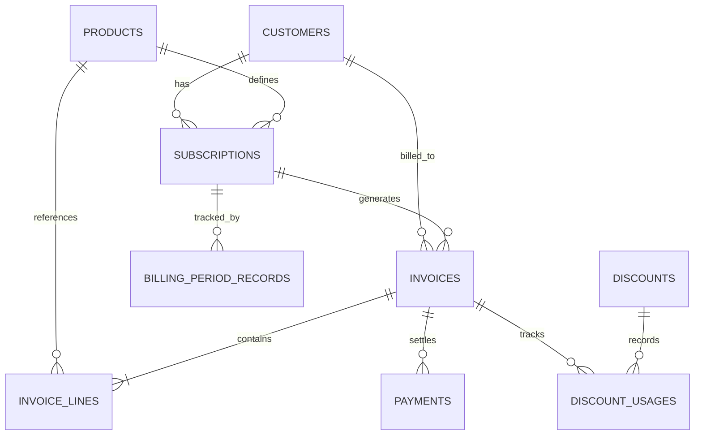

# Database Architecture & Schema Specification

**Database Name:** `subscription_management`  
**Engine:** MySQL 8.0+ (InnoDB, `utf8mb4_unicode_ci`)

---

## 1. Schema Overview

Module 3 coordinates with Module 1 (Auth/Customer) and Module 2 (Product/Subscription) to manage invoices, taxes, discounts, payments, and automated recurring billing cycles.



---

## 2. Shared Models (Module 1 & Module 2 Coordination)

### `customers` (Module 1)
| Column | Type | Constraints | Description |
|---|---|---|---|
| `id` | BIGINT | PRIMARY KEY, AUTO_INCREMENT | Customer identifier |
| `name` | VARCHAR(150) | NOT NULL | Customer / Company legal name |
| `email` | VARCHAR(150) | NOT NULL, UNIQUE | Billing email |
| `phone` | VARCHAR(50) | NULL | Contact phone |
| `billing_address`| VARCHAR(255) | NOT NULL | Physical billing address |
| `country` | VARCHAR(100) | NOT NULL | Country code or name (used for tax calculation) |
| `state` | VARCHAR(100) | NULL | State / Province (used for tax calculation) |
| `tax_number` | VARCHAR(100) | NULL | VAT / GST / Tax registration number |
| `status` | VARCHAR(30) | NOT NULL DEFAULT 'ACTIVE' | Account status |

### `products` (Module 2)
| Column | Type | Constraints | Description |
|---|---|---|---|
| `id` | BIGINT | PRIMARY KEY, AUTO_INCREMENT | Product identifier |
| `sku` | VARCHAR(100) | NOT NULL, UNIQUE | Stock keeping unit / code |
| `name` | VARCHAR(150) | NOT NULL | Product or plan title |
| `description` | TEXT | NULL | Detailed features |
| `unit_price` | DECIMAL(12, 2) | NOT NULL | Standard unit price |
| `billing_interval` | VARCHAR(30) | NOT NULL DEFAULT 'MONTHLY' | Default cycle (`DAILY`, `WEEKLY`, `MONTHLY`, `YEARLY`) |
| `is_active` | BOOLEAN | NOT NULL DEFAULT TRUE | Available for subscriptions |

### `subscriptions` (Module 2)
| Column | Type | Constraints | Description |
|---|---|---|---|
| `id` | BIGINT | PRIMARY KEY, AUTO_INCREMENT | Subscription identifier |
| `subscription_number` | VARCHAR(100) | NOT NULL, UNIQUE | Human-readable subscription identifier |
| `customer_id` | BIGINT | NOT NULL, FK(`customers.id`) | Subscriber reference |
| `product_id` | BIGINT | NOT NULL, FK(`products.id`) | Plan / product reference |
| `status` | VARCHAR(30) | NOT NULL DEFAULT 'ACTIVE' | `ACTIVE`, `CANCELLED`, `EXPIRED`, `SUSPENDED`, `PAUSED` |
| `billing_interval` | VARCHAR(30) | NOT NULL | `DAILY`, `WEEKLY`, `MONTHLY`, `YEARLY` |
| `unit_price` | DECIMAL(12, 2) | NOT NULL | Locked agreed price |
| `quantity` | INT | NOT NULL DEFAULT 1 | Number of licenses / seats |
| `start_date` | DATE | NOT NULL | Commencement date |
| `end_date` | DATE | NULL | Termination date |
| `next_billing_date` | DATE | NOT NULL | Next due billing evaluation date |
| `auto_renew` | BOOLEAN | NOT NULL DEFAULT TRUE | Automatic renewal flag |

---

## 3. Module 3 Tables

### `invoices`
Stores legal billing records with snapshot financial computations.

| Column | Type | Constraints | Description |
|---|---|---|---|
| `id` | BIGINT | PRIMARY KEY, AUTO_INCREMENT | Unique internal ID |
| `invoice_number` | VARCHAR(100) | NOT NULL, UNIQUE | Unique external reference (`INV-YYYYMM-XXXX`) |
| `subscription_id` | BIGINT | NULL, FK(`subscriptions.id`) | Related subscription |
| `customer_id` | BIGINT | NOT NULL, FK(`customers.id`) | Related customer |
| `customer_name` | VARCHAR(150) | NOT NULL | Snapshot of customer name |
| `customer_email` | VARCHAR(150) | NOT NULL | Snapshot of customer email |
| `billing_address` | VARCHAR(255) | NOT NULL | Snapshot of billing address |
| `invoice_date` | DATE | NOT NULL | Date of issuance |
| `due_date` | DATE | NOT NULL | Due date for payment settlement |
| `billing_period_start` | DATE | NULL | Cycle start date |
| `billing_period_end` | DATE | NULL | Cycle end date |
| `subtotal` | DECIMAL(12, 2) | NOT NULL DEFAULT 0.00 | Sum of line subtotals |
| `tax_rate` | DECIMAL(6, 2) | NOT NULL DEFAULT 0.00 | Applicable tax percentage |
| `tax_amount` | DECIMAL(12, 2) | NOT NULL DEFAULT 0.00 | Calculated tax |
| `tax_rule_name` | VARCHAR(100) | NULL | Name of applied tax rule |
| `discount_code` | VARCHAR(50) | NULL | Applied discount code |
| `discount_amount` | DECIMAL(12, 2) | NOT NULL DEFAULT 0.00 | Deducted discount |
| `total_amount` | DECIMAL(12, 2) | NOT NULL DEFAULT 0.00 | Final total payable |
| `amount_paid` | DECIMAL(12, 2) | NOT NULL DEFAULT 0.00 | Total payments recorded |
| `outstanding_balance` | DECIMAL(12, 2) | NOT NULL DEFAULT 0.00 | `total_amount - amount_paid` |
| `status` | VARCHAR(30) | NOT NULL DEFAULT 'DRAFT' | `DRAFT`, `CONFIRMED`, `PAID`, `CANCELLED` |
| `payment_status` | VARCHAR(30) | NOT NULL DEFAULT 'UNPAID' | `UNPAID`, `PARTIALLY_PAID`, `PAID` |
| `sent_at` | DATETIME | NULL | Timestamp when invoice was emailed/dispatched |
| `notes` | TEXT | NULL | Terms and notes |

### `invoice_lines`
Individual items within an invoice.

| Column | Type | Constraints | Description |
|---|---|---|---|
| `id` | BIGINT | PRIMARY KEY, AUTO_INCREMENT | Unique line ID |
| `invoice_id` | BIGINT | NOT NULL, FK(`invoices.id`) | Parent invoice (CASCADE DELETE) |
| `product_id` | BIGINT | NULL, FK(`products.id`) | Referenced product |
| `product_name` | VARCHAR(150) | NOT NULL | Product name snapshot |
| `description` | VARCHAR(255) | NULL | Line item description |
| `quantity` | INT | NOT NULL DEFAULT 1 | Units |
| `unit_price` | DECIMAL(12, 2) | NOT NULL | Price per unit |
| `subtotal` | DECIMAL(12, 2) | NOT NULL | `quantity * unit_price` |
| `tax_rate` | DECIMAL(6, 2) | NOT NULL DEFAULT 0.00 | Tax rate percentage |
| `tax_amount` | DECIMAL(12, 2) | NOT NULL DEFAULT 0.00 | Tax amount |
| `discount_amount`| DECIMAL(12, 2) | NOT NULL DEFAULT 0.00 | Item discount |
| `line_total` | DECIMAL(12, 2) | NOT NULL | Final line item total |

### `payments`
Recorded payment transactions.

| Column | Type | Constraints | Description |
|---|---|---|---|
| `id` | BIGINT | PRIMARY KEY, AUTO_INCREMENT | Payment record ID |
| `payment_reference` | VARCHAR(100) | NOT NULL, UNIQUE | Unique transaction reference |
| `invoice_id` | BIGINT | NOT NULL, FK(`invoices.id`) | Invoice receiving allocation |
| `payment_method` | VARCHAR(50) | NOT NULL | `CREDIT_CARD`, `BANK_TRANSFER`, `CASH`, `CHECK`, `ONLINE_GATEWAY`, `OTHER` |
| `amount` | DECIMAL(12, 2) | NOT NULL | Payment amount |
| `payment_date` | DATETIME | NOT NULL | Timestamp of payment |
| `notes` | TEXT | NULL | Reconciliation / payment audit log |
| `status` | VARCHAR(30) | NOT NULL DEFAULT 'COMPLETED'| `COMPLETED`, `REFUNDED`, `FAILED` |

### `billing_period_records` (Duplicate Billing Prevention)
Tracks billed cycles per subscription.

| Column | Type | Constraints | Description |
|---|---|---|---|
| `id` | BIGINT | PRIMARY KEY, AUTO_INCREMENT | Tracking ID |
| `subscription_id` | BIGINT | NOT NULL, FK(`subscriptions.id`) | Subscription billed |
| `period_start` | DATE | NOT NULL | Cycle starting date |
| `period_end` | DATE | NOT NULL | Cycle ending date |
| `invoice_id` | BIGINT | NOT NULL, FK(`invoices.id`) | Generated invoice reference |
| `billing_date` | DATE | NOT NULL | Date processed |
| `status` | VARCHAR(30) | NOT NULL DEFAULT 'GENERATED'| Record status |

**Unique Constraint:**
```sql
CONSTRAINT `uk_sub_period` UNIQUE (`subscription_id`, `period_start`, `period_end`)
```
This guarantees at the database level that no subscription can ever be billed twice for the same period.

### `discounts`
Configurable discount rules.

| Column | Type | Constraints | Description |
|---|---|---|---|
| `id` | BIGINT | PRIMARY KEY, AUTO_INCREMENT | Discount ID |
| `code` | VARCHAR(50) | NOT NULL, UNIQUE | Promo code (e.g., `SUMMER25`) |
| `description` | VARCHAR(255) | NULL | Description |
| `discount_type` | VARCHAR(30) | NOT NULL | `FIXED_AMOUNT` or `PERCENTAGE` |
| `discount_value` | DECIMAL(12, 2) | NOT NULL | Percentage or dollar amount |
| `min_purchase_amount` | DECIMAL(12, 2) | NULL | Minimum cart subtotal |
| `min_quantity` | INT | NULL | Minimum total quantity |
| `start_date` | DATE | NULL | Start validity |
| `end_date` | DATE | NULL | End validity |
| `max_usage_count` | INT | NULL | Total allowed redemptions |
| `current_usage_count` | INT | NOT NULL DEFAULT 0 | Redemptions consumed |
| `applicable_product_id` | BIGINT | NULL, FK(`products.id`) | Product-specific discount |
| `applicable_subscription_id` | BIGINT | NULL, FK(`subscriptions.id`) | Subscription-specific discount |
| `is_active` | BOOLEAN | NOT NULL DEFAULT TRUE | Toggle active state |
| `version` | BIGINT | NOT NULL DEFAULT 0 | Optimistic concurrency locking |

### `tax_rules`
Configurable jurisdiction tax rates.

| Column | Type | Constraints | Description |
|---|---|---|---|
| `id` | BIGINT | PRIMARY KEY, AUTO_INCREMENT | Tax rule ID |
| `rule_name` | VARCHAR(100) | NOT NULL | Name (e.g. `Standard VAT`, `California State Tax`) |
| `rate_percentage` | DECIMAL(6, 2) | NOT NULL | Tax rate percentage |
| `country` | VARCHAR(100) | NULL | Applicable country code |
| `state` | VARCHAR(100) | NULL | Applicable state / province |
| `is_active` | BOOLEAN | NOT NULL DEFAULT TRUE | Active toggle |
| `description` | VARCHAR(255) | NULL | Rule description |
